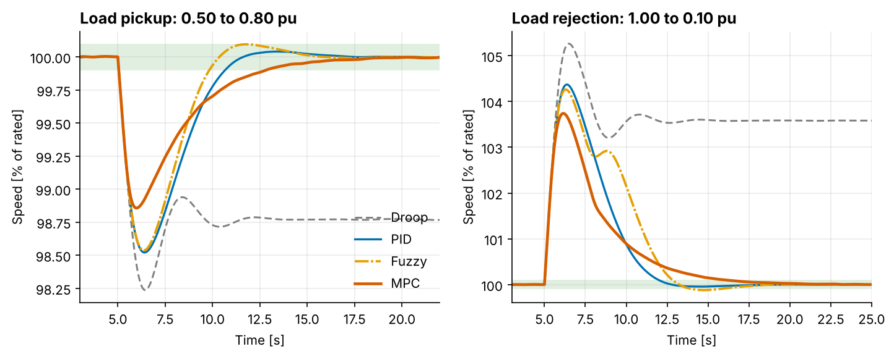
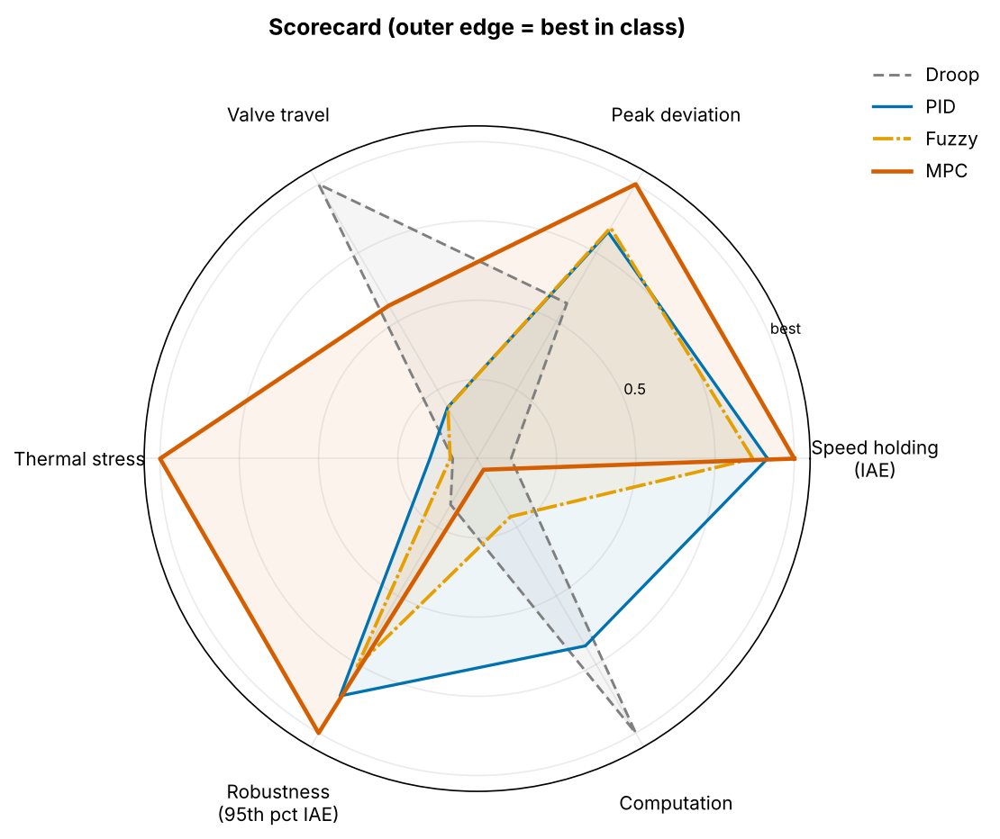
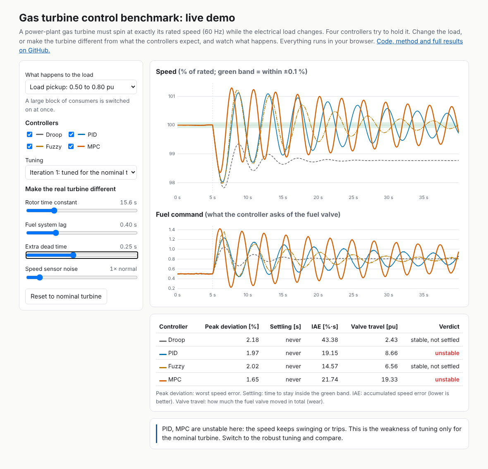
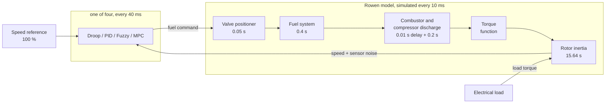

# Gas Turbine Control Benchmark

[](https://github.com/DARS1198/gas-turbine-control-benchmark/actions/workflows/ci.yml)
[](LICENSE)

**Four ways to control the speed of a power-plant gas turbine, compared fairly, with every number reproducible from one command.**

**[Try the live demo in your browser](https://dars1198.github.io/gas-turbine-control-benchmark/)** · [Results](docs/05-results.md) · [How it was tested](docs/04-methodology.md)



## In plain words

A gas turbine that feeds an isolated electrical grid has one job above all others: keep spinning at exactly its rated speed, because that speed *is* the grid frequency (60 Hz). Every time consumers switch on or off, the turbine slows down or speeds up, and a controller has to move the fuel valve to bring it back. If it reacts too slowly, the frequency sags. If it reacts too hard, the speed swings back and forth, and in the worst case the unit trips.

This project builds a simulator of such a turbine from a published model and uses it to answer three questions:

1. **Which controller holds the speed best?** A classic droop governor, a PID, a fuzzy-logic controller and a model predictive controller (MPC) are compared on the same events.
2. **What does it cost?** Fuel-valve movement, thermal stress and computing time are measured, not only speed.
3. **Does it still work when the real turbine is not the one you designed for?** Each controller is tested on 300 turbines with different inertia, slower fuel systems and extra delay.

## Headline results

Final designs on the nominal turbine. Lower is better in every column.

| Controller | Load pickup: worst speed dip | Load pickup: accumulated error (IAE) | Load rejection: highest speed | Fuel-valve travel (mean of 4 tests) | Unstable on 300 perturbed turbines |
|---|---|---|---|---|---|
| Droop (baseline) | 1.76 % | 43.1 %·s | 105.3 % | 3.7 pu | 0 of 600 runs, but never returns to 60 Hz |
| PID | 1.48 % | 4.8 %·s | 104.4 % | 21.9 pu | 0 of 600 |
| Fuzzy | 1.46 % | 4.5 %·s | 104.3 % | 22.0 pu | 0 of 600 |
| **MPC** | **1.14 %** | **4.3 %·s** | **103.7 %** | **7.0 pu** | 0 of 600 |

What the numbers say:

- **MPC wins on speed and on valve wear at the same time.** It dips 23 % less than PID on a load pickup and moves the fuel valve about three times less, because it filters sensor noise with a model instead of reacting to it.
- **Fuzzy logic did not earn its extra complexity here.** After fair tuning it performs like the PID, within a few percent either way.
- **The droop governor is the most forgiving and the least accurate.** It never goes unstable in the 300-turbine study, but it leaves the frequency 0.7 Hz low after a 30 % load pickup.
- **MPC is not best at everything.** It takes the longest to settle completely (7.8 s against 5.7 s for PID after a load pickup), because its robust tuning approaches the reference cautiously.
- **MPC costs 10 times more computation than PID** (about 8 µs against 0.7 µs per control cycle in Python, 51 µs when the fuel limit is active), which is still a tiny fraction of the 40 ms cycle.



## The finding that changed the design

The first version tuned each controller for the best possible response on the nominal turbine. On paper it looked excellent. On 300 turbines with realistic parameter differences, **6 to 7 % of the runs were unstable** for every tuned controller.

| Controller | Iteration 1: tuned on the nominal turbine | Iteration 2: robust tuning (final) | Price paid in nominal performance |
|---|---|---|---|
| PID | 44 of 600 runs unstable | 0 of 600 | IAE +7 % |
| Fuzzy | 39 of 600 runs unstable | 0 of 600 | none (−1 %) |
| MPC | 35 of 600 runs unstable | 0 of 600 | IAE +71 % |

The second iteration tunes against the nominal turbine *and* two worst-case turbines. All instability disappeared. MPC gave up the most nominal performance to get there and still finished first. You can reproduce this in the [demo](https://dars1198.github.io/gas-turbine-control-benchmark/): choose the iteration 1 tuning and add 0.25 s of extra dead time.

This is the practical lesson of the project: **a controller optimised for the model is not a controller that is safe on the machine.** Details in [docs/05-results.md](docs/05-results.md).

## Try it

**In the browser:** the [live demo](https://dars1198.github.io/gas-turbine-control-benchmark/) runs the same simulator, ported to JavaScript and verified against the Python version to 7 decimal places.



**On your machine** (Python 3.10 or newer):

```bash
git clone https://github.com/DARS1198/gas-turbine-control-benchmark.git
cd gas-turbine-control-benchmark
pip install -e ".[dev]"

gtbench run      # runs the whole benchmark (about 1 minute), writes results/
gtbench tune     # optional: re-tunes every controller from scratch (about 5 minutes)
pytest           # 46 tests
```

Everything is seeded. `gtbench tune` followed by `gtbench run` regenerates the committed tuning values, tables and figures.

## How it works



- **The turbine** is W. I. Rowen's simplified heavy-duty gas turbine model (1983), a standard in power-system studies. See [docs/02-plant-model.md](docs/02-plant-model.md).
- **The controllers** all receive the same two signals (speed reference and noisy measured speed) and nothing else. See [docs/03-controllers.md](docs/03-controllers.md).
- **The comparison is fair by construction**: one optimiser, one cost function, tuning scenarios that are different from the test scenarios. See [docs/04-methodology.md](docs/04-methodology.md).

## Documentation

| If you want... | Read |
|---|---|
| The idea without the maths | this page, then the [glossary](docs/glossary.md) |
| Why and how the project was planned | [01 Project plan](docs/01-project-plan.md) |
| The turbine equations and their source | [02 Plant model](docs/02-plant-model.md) |
| How each controller works | [03 Controllers](docs/03-controllers.md) |
| What was measured and why it is fair | [04 Methodology](docs/04-methodology.md) |
| All results with interpretation | [05 Results](docs/05-results.md) |
| What this does *not* show, and next steps | [06 Limitations and roadmap](docs/06-limitations-and-roadmap.md) |
| Raw tables and figures | [results/RESULTS.md](results/RESULTS.md) |

## Repository map

```
src/gtbench/
  plant.py          turbine model
  controllers/      droop.py, pid.py, fuzzy.py, mpc.py (all written from scratch)
  scenarios.py      load events used for tuning and for testing
  simulate.py       closed-loop simulation
  metrics.py        the numbers reported
  tuning.py         automatic tuning, nominal and robust
  benchmark.py      test scenarios, 300-turbine study, parameter sweeps
  report.py         figures and results/RESULTS.md
  tuned.json        the tuned parameters used for every result
tests/              46 Python tests, plus a JavaScript-versus-Python parity test
docs/               documentation, and the browser demo (index.html, sim.js)
results/            generated tables (CSV), figures and RESULTS.md
```

Dependencies are NumPy, SciPy and Matplotlib only. The fuzzy inference, the MPC and its quadratic-program solver are implemented in this repository, not imported.

## Limitations

This is a simulation study on a simplified, published model. It has not been validated against plant data, it leaves out the temperature and acceleration control loops that a real turbine controller also runs, and it models an isolated unit, not one synchronised to a large grid. It is a benchmark of control methods, not a design for a real unit. The full list is in [docs/06-limitations-and-roadmap.md](docs/06-limitations-and-roadmap.md).

No proprietary or plant data is used anywhere. The model and its parameters come from the open literature.

## References

1. W. I. Rowen, "Simplified Mathematical Representations of Heavy-Duty Gas Turbines," *ASME Journal of Engineering for Power*, vol. 105, no. 4, pp. 865-869, 1983.
2. S. K. Yee, J. V. Milanović, F. M. Hughes, "Overview and Comparative Analysis of Gas Turbine Models for System Stability Studies," *IEEE Transactions on Power Systems*, vol. 23, no. 1, pp. 108-118, 2008.

## Author and license

Diego Adrian Ramirez Salazar, controls engineer working on gas-turbine control systems in power plants. [Portfolio](https://dars1198.github.io) · [GitHub](https://github.com/DARS1198)

Released under the [MIT License](LICENSE).
