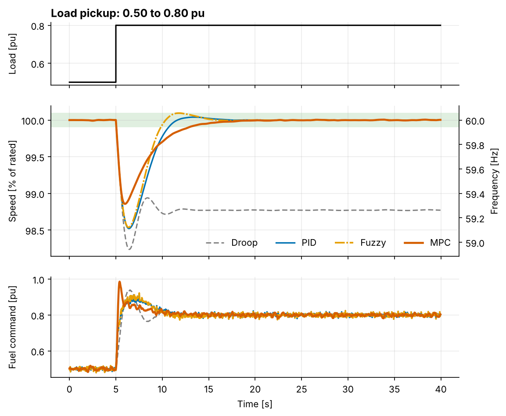
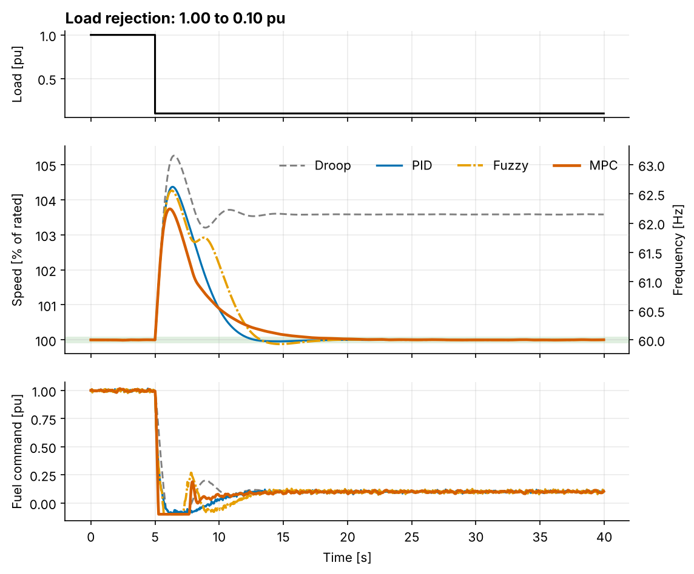
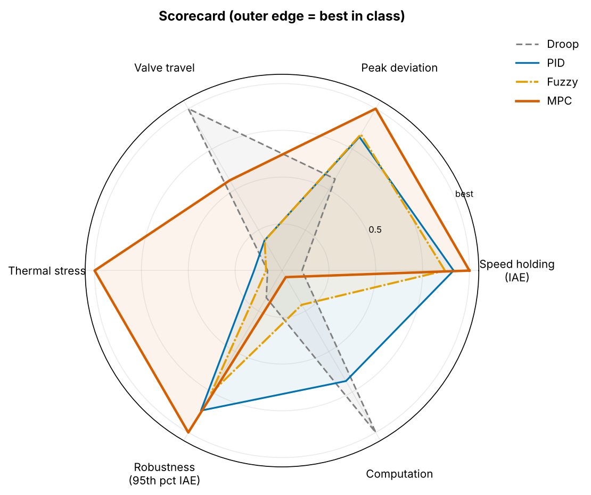
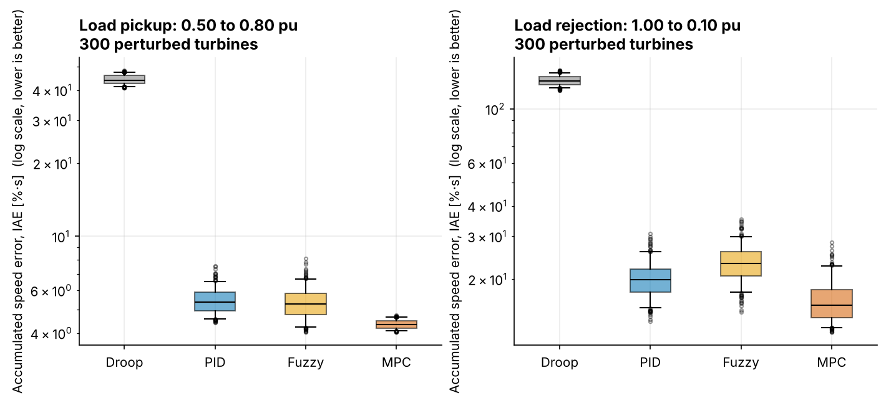
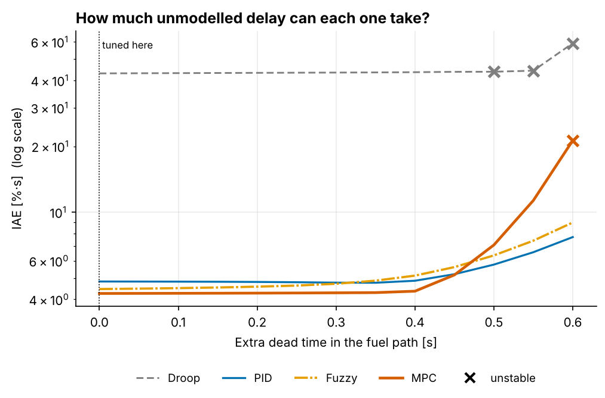

# 05. Results

All numbers come from the committed files in [`results/`](../results/RESULTS.md) and are regenerated by `gtbench run`. Unless stated otherwise they refer to the final (robust) tuning.

## Summary

1. Any controller with integral action beats the droop governor by roughly a factor of ten in accumulated speed error, because droop never returns to the reference.
2. MPC has the smallest speed excursion in all four tests and moves the fuel valve about three times less than PID or fuzzy.
3. MPC is the slowest of the three to settle completely, and the most expensive to compute.
4. The fuzzy controller and the PID are practically tied.
5. Tuning for the nominal turbine alone produced controllers that were unstable on 6 to 7 % of realistic turbines. Robust tuning removed every unstable case.

## 1. Nominal turbine

### Load pickup, 0.50 to 0.80 pu

| Controller | Speed dip [%] | Dip [Hz] | Settling [s] | IAE [%·s] | Valve travel [pu] |
|---|---|---|---|---|---|
| Droop | 1.76 | 1.06 | never (stays 1.23 % low) | 43.07 | 1.82 |
| PID | 1.48 | 0.89 | 5.7 | 4.83 | 9.76 |
| Fuzzy | 1.46 | 0.88 | 4.8 | 4.46 | 9.83 |
| MPC | 1.14 | 0.69 | 7.8 | 4.26 | 3.31 |

The first second looks the same for every controller: the load is already on the shaft, and no new fuel can arrive faster than the fuel system allows. The differences are in what happens next. MPC limits the dip best, then approaches the reference slowly and without overshoot. PID and fuzzy dip further, recover faster and overshoot slightly.

### Load rejection, 1.00 to 0.10 pu

| Controller | Highest speed [%] | Margin to 110 % trip | Settling [s] | IAE [%·s] |
|---|---|---|---|---|
| Droop | 105.26 | 4.7 | never (stays 3.58 % high) | 126.44 |
| PID | 104.37 | 5.6 | 7.0 | 14.75 |
| Fuzzy | 104.26 | 5.7 | 10.6 | 18.32 |
| MPC | 103.74 | 6.3 | 11.1 | 13.49 |

Every controller drives the fuel command to its lower limit within a fraction of a second, so the first overspeed peak is set mostly by physics: rotor inertia and the fuel already in the system. The controller decides how soon the command reaches the limit and how cleanly it leaves it. MPC knows the limit exists and plans around it; the other two hit it and rely on anti-windup to recover.

### Block loading and noisy sensor

| Controller | Block loading: IAE [%·s] | Block loading: over-temperature [°F·s] | Noisy sensor: valve travel [pu] |
|---|---|---|---|
| Droop | 153.63 | 20.9 | 6.5 |
| PID | 11.96 | 10.3 | 47.9 |
| Fuzzy | 11.02 | 18.6 | 48.2 |
| MPC | 10.54 | 0.0 | 13.9 |

- **Thermal stress.** The last block ends at 95 % load. Droop, PID and fuzzy over-fuel briefly while recovering speed and push the exhaust temperature above rated for a moment; MPC does not.
- **Valve wear.** With a noisy speed signal PID and fuzzy move the valve about 3.5 times more than MPC. Their robustness comes from derivative action, which amplifies noise. MPC gets the same information from its model and Kalman filter, without differentiating the signal.

Figures: [block loading](../results/figures/scenario_blocks.png), [noisy sensor](../results/figures/scenario_noisy.png).

## 2. Scorecard

Each axis is scaled so that the best controller on that axis touches the outer edge. Droop is best only where doing little is rewarded: valve travel and computation.

| Controller | IAE [%·s] | Peak deviation [%] | Valve travel [pu] | Over-temp [°F·s] | 95th pct IAE on perturbed turbines [%·s] | CPU [µs/frame] |
|---|---|---|---|---|---|---|
| Droop | 84.38 | 2.79 | 3.72 | 5.24 | 138.93 | 0.4 |
| PID | 8.35 | 1.89 | 21.85 | 2.65 | 24.67 | 0.8 |
| Fuzzy | 8.88 | 1.86 | 22.03 | 4.73 | 28.63 | 3.3 |
| MPC | 7.50 | 1.55 | 7.02 | 0.31 | 20.96 | 18.6 |

The MPC average of 18.6 µs is pulled up by the load rejection, where the constrained solver runs (51 µs); otherwise it needs about 7.5 µs. All of these are Python timings on a development machine and are small against a 40 ms frame. They show relative cost, not what a PLC would need.

## 3. Robustness: 300 perturbed turbines

| Event | Controller | Passed | Unstable | IAE median [%·s] | IAE 95th pct [%·s] | Highest speed seen [%] |
|---|---|---|---|---|---|---|
| Pickup | PID | 100 % | 0 | 5.38 | 6.54 | 100.40 |
| Pickup | Fuzzy | 100 % | 0 | 5.28 | 6.68 | 100.59 |
| Pickup | MPC | 100 % | 0 | 4.33 | 4.65 | 100.01 |
| Rejection | PID | 100 % | 0 | 19.89 | 25.93 | 107.17 |
| Rejection | Fuzzy | 100 % | 0 | 23.22 | 29.91 | 107.16 |
| Rejection | MPC | 100 % | 0 | 15.64 | 22.70 | 106.87 |

- MPC is not only better on average, it is more consistent: on the load pickup its 95th percentile is 7 % above its median, against 22 % for PID and 27 % for fuzzy.
- On the lightest rotors a full load rejection reaches 107 % with every controller, 3 % below the trip. Droop reaches 108.35 %.
- Droop passes no run under the settling criterion, because it never returns to the reference, but it is never unstable either.

### How far can each design be pushed?

| Extra dead time | Droop | PID | Fuzzy | MPC |
|---|---|---|---|---|
| up to 0.40 s | stable | stable, IAE flat | stable | stable, IAE flat |
| 0.50 s | **unstable** | stable | stable | stable, IAE +66 % |
| 0.60 s | unstable | stable, IAE +59 % | stable, IAE +101 % | **unstable** |

The designs were tuned for at most 0.15 s of extra dead time and tolerate about three times that. PID and fuzzy degrade gradually. MPC holds its performance longer and then fails more abruptly: its model contains no delay, so beyond a point its predictions are simply wrong. The untuned droop governor, with its fixed gain of 25, fails first.

For rotor time constants from 8 to 40 s every design stays stable. MPC's IAE moves by 8 % over that range, PID's by 53 %.

## 4. Design iteration

| Controller | Tuning | Unstable runs (of 600) | Mean IAE on the nominal test events [%·s] |
|---|---|---|---|
| PID | 1: nominal | 44 | 7.80 |
| PID | 2: robust | 0 | 8.35 |
| Fuzzy | 1: nominal | 39 | 8.97 |
| Fuzzy | 2: robust | 0 | 8.88 |
| MPC | 1: nominal | 35 | 4.39 |
| MPC | 2: robust | 0 | 7.50 |

What the optimiser changed to buy robustness (`results/tuned_parameters.json`):

| Controller | Iteration 1 | Iteration 2 | In words |
|---|---|---|---|
| PID | Kp 27.8, Ki 9.8, Kd ≈ 0 | Kp 18.9, Ki 6.6, Kd 6.8 | A pure PI with high gain became a lower-gain PID. The derivative term adds damping, and noise sensitivity with it. |
| Fuzzy | Kde ≈ 1 (rate input unused) | Kde 10.2, lower Ki | The same move: it started using the rate of change. |
| MPC | load variance 2.3e-7 | load variance 3.4e-9 | The load estimate was made slower. A fast estimator mistakes model error for load changes and fights itself. |

Reading:

- **Iteration 1 MPC was spectacular and fragile.** Its nominal IAE was 44 % lower than the PID's. It was also unstable on 35 runs.
- **Robustness cost MPC the most** (IAE +71 %) because it had the most to lose: its advantage came from trusting the model.
- **After paying that price MPC still leads**, by 10 % in IAE and by a factor of three in valve travel.

## 5. What I would tell a plant engineer

- If the unit runs isolated, droop alone is not enough; some integral action is needed to hold frequency.
- A well-tuned PID gets most of the benefit. Going from droop to PID cuts accumulated speed error by 90 %; going from PID to MPC cuts a further 10 %.
- The case for MPC on this problem is not the speed trace. It is the quieter fuel valve and the absence of over-firing, which matter for maintenance.
- Whatever the method, test it on the turbine you might have, not only on the one in the model.
