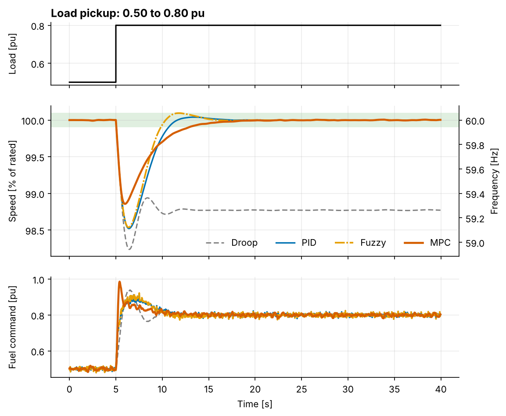
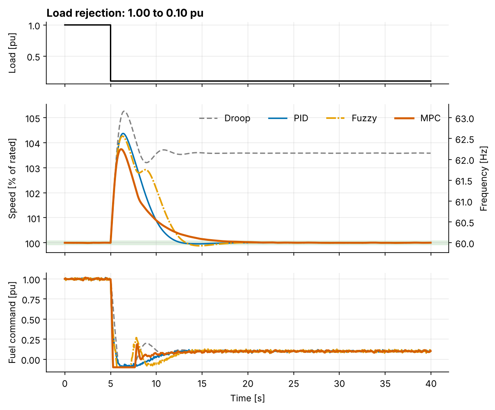
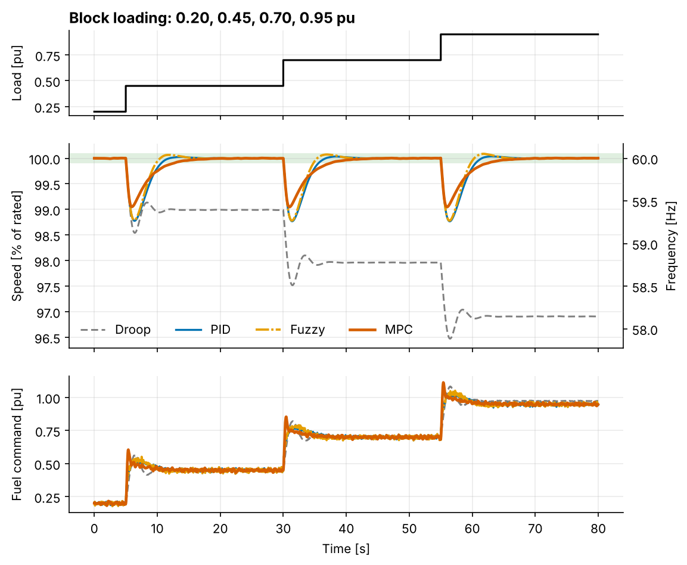
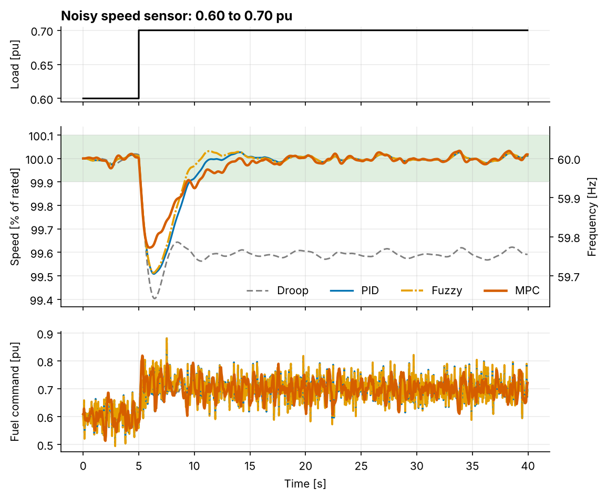
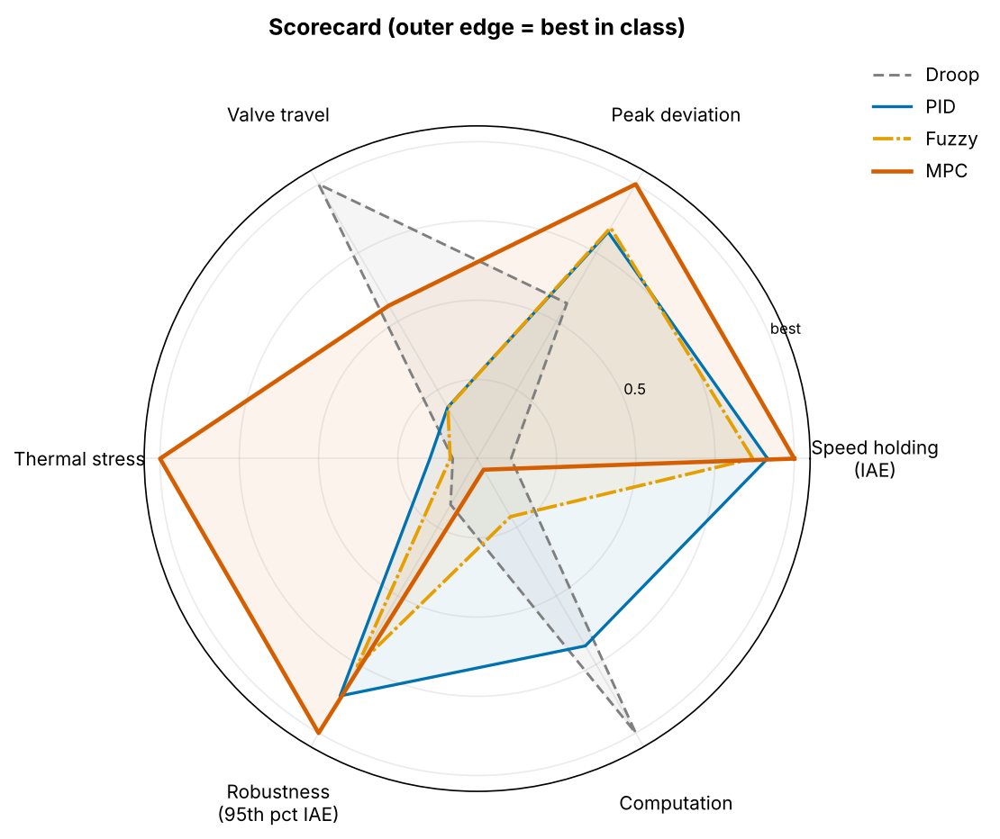
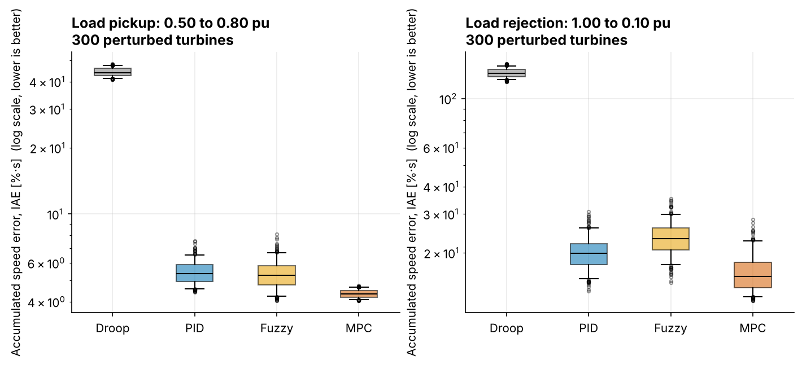
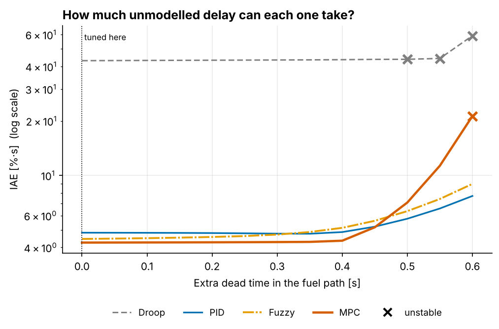
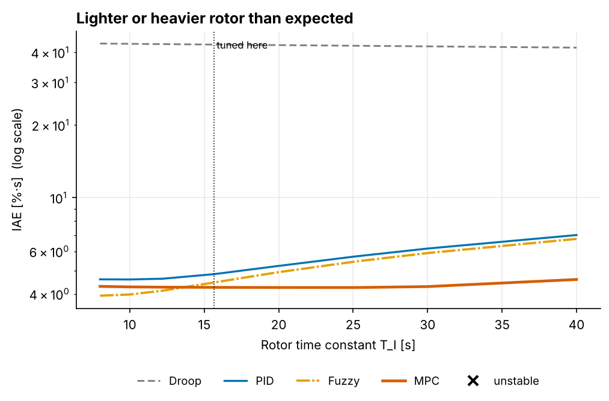

# Benchmark results (generated file)

> Generated by `gtbench run`. Do not edit by hand. The interpretation is in [docs/05-results.md](../docs/05-results.md).

## 1. Nominal turbine, test scenarios

### Load pickup: 0.50 to 0.80 pu

A large block of consumers is switched on at once.

| Controller | Peak deviation [%] | Max speed [%] | Settling [s] | IAE [%·s] | Final error [%] | Valve travel [pu] | Over-temp [°F·s] | CPU [µs/frame] |
|---|---|---|---|---|---|---|---|---|
| Droop | 1.76 | 100.00 | never | 43.07 | 1.229 | 1.82 | 0.0 | 0.4 |
| PID | 1.48 | 100.04 | 5.68 | 4.83 | 0.002 | 9.76 | 0.0 | 0.7 |
| Fuzzy | 1.46 | 100.10 | 4.84 | 4.46 | 0.002 | 9.83 | 0.0 | 3.4 |
| MPC | 1.14 | 100.01 | 7.84 | 4.26 | 0.002 | 3.31 | 0.0 | 7.5 |

### Load rejection: 1.00 to 0.10 pu

The turbine suddenly loses 90 % of its load (a breaker opens). The danger is overspeed.

| Controller | Peak deviation [%] | Max speed [%] | Settling [s] | IAE [%·s] | Final error [%] | Valve travel [pu] | Over-temp [°F·s] | CPU [µs/frame] |
|---|---|---|---|---|---|---|---|---|
| Droop | 5.26 | 105.26 | never | 126.44 | 3.582 | 2.65 | 0.1 | 0.4 |
| PID | 4.37 | 104.37 | 7.00 | 14.75 | 0.002 | 10.36 | 0.3 | 0.8 |
| Fuzzy | 4.26 | 104.26 | 10.60 | 18.32 | 0.002 | 10.55 | 0.3 | 3.1 |
| MPC | 3.74 | 103.74 | 11.12 | 13.49 | 0.002 | 4.11 | 1.2 | 51.4 |

### Block loading: 0.20, 0.45, 0.70, 0.95 pu

Load is added in three blocks, as when restoring a grid after a blackout.

| Controller | Peak deviation [%] | Max speed [%] | Settling [s] | IAE [%·s] | Final error [%] | Valve travel [pu] | Over-temp [°F·s] | CPU [µs/frame] |
|---|---|---|---|---|---|---|---|---|
| Droop | 3.53 | 100.00 | never | 153.63 | 3.091 | 3.85 | 20.9 | 0.4 |
| PID | 1.23 | 100.04 | 5.52 | 11.96 | 0.001 | 19.39 | 10.3 | 0.7 |
| Fuzzy | 1.22 | 100.09 | 4.76 | 11.02 | 0.001 | 19.54 | 18.6 | 3.3 |
| MPC | 0.95 | 100.00 | 7.40 | 10.54 | 0.002 | 6.73 | 0.0 | 7.4 |

### Noisy speed sensor: 0.60 to 0.70 pu

A small load change measured with a speed signal five times noisier than normal.

| Controller | Peak deviation [%] | Max speed [%] | Settling [s] | IAE [%·s] | Final error [%] | Valve travel [pu] | Over-temp [°F·s] | CPU [µs/frame] |
|---|---|---|---|---|---|---|---|---|
| Droop | 0.60 | 100.02 | never | 14.37 | 0.408 | 6.54 | 0.0 | 0.4 |
| PID | 0.49 | 100.03 | 4.56 | 1.85 | 0.010 | 47.88 | 0.0 | 0.8 |
| Fuzzy | 0.49 | 100.03 | 4.12 | 1.72 | 0.011 | 48.21 | 0.0 | 3.2 |
| MPC | 0.38 | 100.03 | 5.40 | 1.71 | 0.012 | 13.91 | 0.0 | 7.8 |

## 2. Scorecard

Raw values behind the radar chart; lower is better on every axis. All are means over the four test scenarios, except robustness, which is the 95th percentile of IAE over the perturbed turbines of section 3. Units: %·s, %, pu, °F·s, %·s, µs per frame.

| Controller | Speed holding (IAE) | Peak deviation | Valve travel | Thermal stress | Robustness (95th pct IAE) | Computation |
|---|---|---|---|---|---|---|
| Droop | 84.38 | 2.79 | 3.72 | 5.24 | 138.93 | 0.39 |
| PID | 8.35 | 1.89 | 21.85 | 2.65 | 24.67 | 0.75 |
| Fuzzy | 8.88 | 1.86 | 22.03 | 4.73 | 28.63 | 3.25 |
| MPC | 7.50 | 1.55 | 7.02 | 0.31 | 20.96 | 18.55 |

## 3. Robustness: 300 perturbed turbines

A run passes if it is stable and settles within ±0.1 % in 20 s. The droop governor never returns to the reference by design, so its pass rate is 0.

| Scenario | Controller | Pass rate [%] | Unstable runs | IAE median [%·s] | IAE 95th pct [%·s] | Worst max speed [%] |
|---|---|---|---|---|---|---|
| pickup | Droop | 0.0 | 0 | 43.92 | 47.26 | 100.01 |
| pickup | PID | 100.0 | 0 | 5.38 | 6.54 | 100.40 |
| pickup | Fuzzy | 100.0 | 0 | 5.28 | 6.68 | 100.59 |
| pickup | MPC | 100.0 | 0 | 4.33 | 4.65 | 100.01 |
| rejection | Droop | 0.0 | 0 | 130.02 | 140.96 | 108.35 |
| rejection | PID | 100.0 | 0 | 19.89 | 25.93 | 107.17 |
| rejection | Fuzzy | 100.0 | 0 | 23.22 | 29.91 | 107.16 |
| rejection | MPC | 100.0 | 0 | 15.64 | 22.70 | 106.87 |

## 4. One-parameter sweeps (load pickup scenario, IAE in %·s, ✗ = unstable)

### Extra dead time [s]

| Dead time [s] | Droop | PID | Fuzzy | MPC |
|---|---|---|---|---|
| 0 | 43.07 | 4.83 | 4.46 | 4.26 |
| 0.05 | 43.13 | 4.82 | 4.48 | 4.26 |
| 0.1 | 43.20 | 4.82 | 4.50 | 4.26 |
| 0.15 | 43.26 | 4.81 | 4.53 | 4.27 |
| 0.2 | 43.32 | 4.80 | 4.57 | 4.27 |
| 0.25 | 43.39 | 4.79 | 4.62 | 4.28 |
| 0.3 | 43.45 | 4.77 | 4.71 | 4.28 |
| 0.35 | 43.52 | 4.76 | 4.87 | 4.29 |
| 0.4 | 43.62 | 4.86 | 5.13 | 4.36 |
| 0.45 | 43.79 | 5.21 | 5.62 | 5.17 |
| 0.5 | 43.83 ✗ | 5.77 | 6.35 | 7.09 |
| 0.55 | 44.32 ✗ | 6.57 | 7.41 | 11.32 |
| 0.6 | 59.16 ✗ | 7.70 | 8.98 | 21.28 ✗ |

### Rotor time constant [s]

| T_I [s] | Droop | PID | Fuzzy | MPC |
|---|---|---|---|---|
| 8 | 43.49 | 4.59 | 3.93 | 4.30 |
| 10 | 43.37 | 4.59 | 3.98 | 4.27 |
| 12.2 | 43.25 | 4.62 | 4.12 | 4.26 |
| 15.64 | 43.07 | 4.83 | 4.46 | 4.26 |
| 20 | 42.85 | 5.22 | 4.92 | 4.25 |
| 25.2 | 42.58 | 5.72 | 5.45 | 4.25 |
| 30 | 42.34 | 6.16 | 5.90 | 4.29 |
| 40 | 41.83 | 7.01 | 6.76 | 4.59 |

## 5. Design iteration: nominal tuning versus robust tuning

Same 300 perturbed turbines, both robustness scenarios pooled. Sections 1 to 4 use the robust tuning.

| Controller | Tuning | Pass rate [%] | Unstable runs | Nominal IAE, mean of test scenarios [%·s] |
|---|---|---|---|---|
| PID | 1: nominal only | 83.0 | 44 of 600 | 7.80 |
| PID | 2: robust (final) | 100.0 | 0 of 600 | 8.35 |
| Fuzzy | 1: nominal only | 78.8 | 39 of 600 | 8.97 |
| Fuzzy | 2: robust (final) | 100.0 | 0 of 600 | 8.88 |
| MPC | 1: nominal only | 87.8 | 35 of 600 | 4.39 |
| MPC | 2: robust (final) | 100.0 | 0 of 600 | 7.50 |

